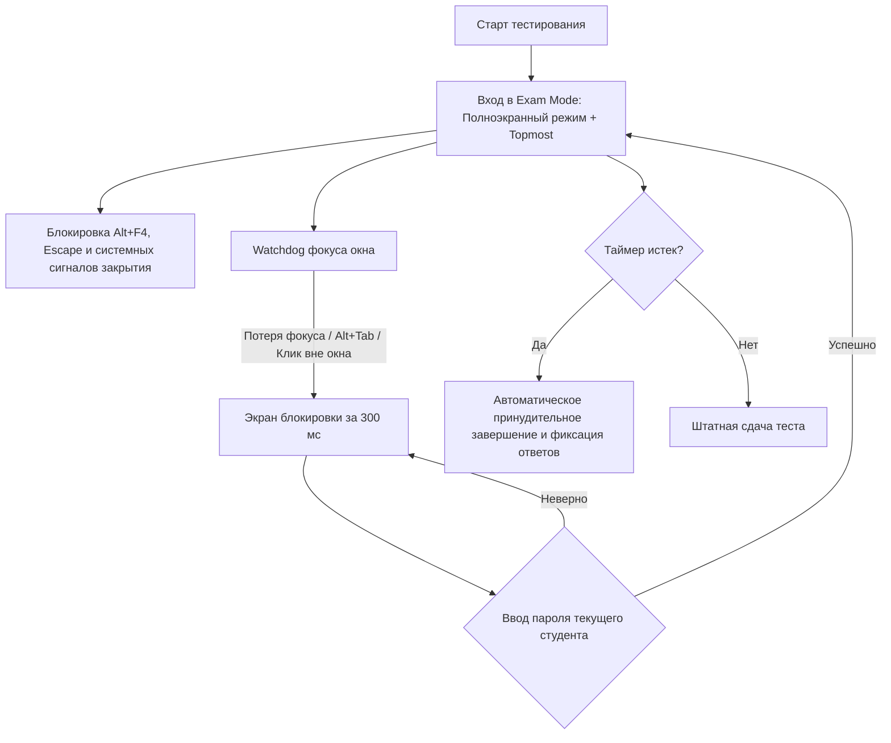

<div align="center">

# 🛡️ ExamGuard (Тестировщик)

**Защищенная десктопная система тестирования и контроля знаний с функциями прокторинга и защиты от списывания**

*A secure, anti-cheat desktop examination & assessment platform built with Python, Tkinter, and SQLite.*

[](https://www.python.org/)
[](https://opensource.org/licenses/MIT)
[](https://microsoft.com)
[-success.svg)](https://docs.python.org/3/library/)
[](https://en.wikipedia.org/wiki/PBKDF2)

---

[О проекте](#-о-проекте) •
[Ключевые возможности](#-ключевые-возможности) •
[Архитектура безопасности](#-архитектура-безопасности-и-античит) •
[Импорт вопросов](#-система-импорта-вопросов) •
[Быстрый старт](#-быстрый-старт) •
[Сборка в EXE](#-сборка-автономного-exe) •
[English Summary](#-english-summary)

</div>

---

## 📌 О проекте

**ExamGuard (Тестировщик)** — это полнофункциональное десктопное приложение для проведения экзаменов, срезов знаний и тестирования студентов или сотрудников в контролируемой среде. 

В отличие от стандартных веб-тестов, ExamGuard работает в **режиме киоска с активным прокторингом**: контролирует фокус окна, предотвращает переход в браузеры, мессенджеры и шпаргалки, перехватывает системные сочетания клавиш и требует пароль авторизованного студента при любой попытке сменить активное окно.

Проект разработан по принципу **Zero External Runtime Dependencies** — ядро и графический интерфейс работают исключительно на стандартной библиотеке Python (`tkinter`, `sqlite3`, `hashlib`, `xml.etree`, `zipfile`), обеспечивая максимальную скорость, надежность и простоту развертывания.

---

## 🌟 Ключевые возможности

### 👤 Для студентов (Examinee Mode)
- **Интуитивный интерфейс тестирования**: таймер реального времени, панель быстрой навигации по вопросам, индикация отвеченных и неотвеченных заданий.
- **Индивидуальная рандомизация**: каждый студент получает уникальную случайную выборку вопросов и перемешанные варианты ответов.
- **Подробные результаты**: подсчет правильных ответов, итоговый процент, статус «Сдано / Не сдано» по установленному проходному баллу.
- **История попыток**: просмотр всех ранее пройденных тестов с датами и баллами.

### 🛠️ Для администраторов (Admin Control Panel)
- **Конструктор тестов**: создание, редактирование и удаление тестов с настройкой времени (минуты), проходного балла (%), размера экзаменационной выборки и флагов рандомизации.
- **Пакетный импорт**: мгновенная загрузка сотен вопросов из файлов Excel (`.xlsx`) или форматированного текста (`.txt`).
- **Журнал результатов**: централизованный мониторинг результатов всех пользователей с сортировкой по дате и времени.
- **Управление доступом**: разграничение ролей пользователей (`user` и `admin`).

---

## 🔒 Архитектура безопасности и античит

ExamGuard включает комплекс мер противодействия списыванию и подмене результатов:



1. **Антифокусный сторожевой таймер (Focus Watchdog)**:
   При попытке переключиться на браузер, Discord, Telegram или калькулятор, приложение в течение 300 мс активирует **Lock Screen**, блокирующий рабочий стол. Разблокировка возможна только паролем текущего экзаменуемого.
2. **Перехват системных хоткеев**:
   Перехватываются и блокируются `Alt+F4`, `Escape`, закрытие через заголовок окна.
3. **Криптографическая защита учетных данных**:
   Пароли пользователей хешируются с использованием `PBKDF2-HMAC-SHA256` (120 000 итераций) с криптографически стойкой 16-байтной солью (`os.urandom(16)`).
4. **Защита от Timing Attacks**:
   Проверка хешей паролей осуществляется через безопасное сравнение за постоянное время (`hmac.compare_digest`).
5. **Безопасность БД**:
   Все запросы к SQLite параметризованы (защита от SQL Injection), включены каскадные внешние ключи (`PRAGMA foreign_keys = ON`).

---

## 📥 Система импорта вопросов

Модуль `Backend/importer.py` поддерживает высокоскоростной парсинг вопросов из `.xlsx` и `.txt` файлов:

### 1. Собственный парсер OpenXML (Excel) без сторонних библиотек
Импорт `.xlsx` реализован через встроенный `zipfile` и `xml.etree.ElementTree`, читающий таблицу `xl/sharedStrings.xml` и листы рабочей книги. Не требует установки тяжелых библиотек (`openpyxl`, `pandas`), работает мгновенно.

### 2. Формат текстового файла (`.txt`)
Разделитель между вопросами — `++++`, разделитель между вопросом и вариантами — `====`. Правильный ответ помечается символом `#`:

```text
Какое свойство CSS отвечает за цвет текста?
====
# color
====
background-color
====
font-weight
====
text-align
++++
```

### 3. Автокоррекция кодировок и Mojibake
Парсер автоматически распознает кодировки `utf-8-sig`, `utf-8`, `cp1251` и исправляет поврежденные символы кириллицы (кракозябры/mojibake).

---

## 📂 Структура репозитория

```text
ExamGuard/
├── .env.example              # Пример конфигурации учетных данных
├── .gitignore                # Исключение баз данных, артефактов сборки и exe
├── LICENSE                   # Лицензия MIT
├── README.md                 # Документация проекта
├── requirements.txt          # Зависимости сборщика (PyInstaller)
├── run_desktop.bat           # Скрипт быстрого запуска
│
├── Backend/
│   ├── __init__.py           # Пакет бэкенда
│   ├── database.py           # Модели SQLite, PBKDF2 хеширование, CRUD операций
│   ├── importer.py           # Парсер Excel (.xlsx) и текстовых тестов (.txt)
│   ├── build_desktop_exe.py  # Автоматизация компиляции через PyInstaller
│   └── README.md             # Инструкция по сборке и настройке бэкенда
│
└── Frontend/
    └── desktop_app.py        # Десктопный GUI (Tkinter), прокторинг, стили и контроллеры
```

---

## 🚀 Быстрый старт

### Требования
- Python **3.10** или выше.
- ОС Windows 10/11 (или Linux/macOS с установленным Tkinter).

### 1. Клонирование репозитория
```bash
git clone https://github.com/magus24/ExamGuard.git
cd ExamGuard
```

### 2. Запуск приложения

Через пакетный файл:
```cmd
run_desktop.bat
```

Или напрямую через Python:
```bash
python Frontend/desktop_app.py
```

При первом запуске приложение **автоматически инициализирует чистую базу данных SQLite** (`desktop_data.db`), накатит схему и создаст стартовый демонстрационный тест.

### 3. Учетные данные по умолчанию

| Роль | Логин | Пароль |
| :--- | :--- | :--- |
| **Администратор** | `admin` | `admin` |
| **Студент** | *Регистрируется через кнопку «Регистрация» в окне входа* |

> 💡 **Настройка администратора через переменные окружения:**  
> Перед первым запуском вы можете задать свои логин и пароль:
> ```powershell
> $env:TESTER_ADMIN_USER="superadmin"
> $env:TESTER_ADMIN_PASSWORD="MySecurePassword123!"
> python Frontend\desktop_app.py
> ```

---

## 📦 Сборка автономного EXE

Для создания одного исполняемого файла `.exe`, не требующего установленного Python:

1. Установите PyInstaller:
   ```bash
   pip install -r requirements.txt
   ```

2. Запустите скрипт сборки:
   ```powershell
   python Backend/build_desktop_exe.py
   ```

3. Готовый бинарник будет сформирован в:
   ```text
   Backend/dist/Тестировщик.exe
   ```

---

## 🌍 English Summary

**ExamGuard** is a standalone desktop examination platform designed for secure, proctored computer-based testing.

### Highlights:
- **Kiosk & Anti-Cheat Engine**: Fullscreen enforcement, Alt+Tab / focus-loss detection triggering a password-protected lock screen within 300ms, and interception of exit hotkeys (`Alt+F4`, `Escape`).
- **Zero External Runtime Dependencies**: Pure Python standard library (`tkinter`, `sqlite3`, `hashlib`, `xml.etree`, `zipfile`).
- **High-Speed XLSX/TXT Importer**: In-house OpenXML spreadsheet parser without heavy dependencies like `openpyxl` or `pandas`, featuring automatic encoding detection and mojibake correction.
- **Enterprise-Grade Security**: PBKDF2-HMAC-SHA256 password hashing (120k iterations) with 16-byte random salt, constant-time verification, and parameterized queries.
- **Exam Customization**: Question pools, time limits, pass thresholds, and random question/answer shuffling.
- **One-Click EXE Packaging**: Pre-configured PyInstaller pipeline to build self-contained Windows executables.

---

## 📄 Лицензия

Проект распространяется под открытой лицензией [MIT](LICENSE). Разрешено свободное использование в учебных, коммерческих и портфолио-целях.
